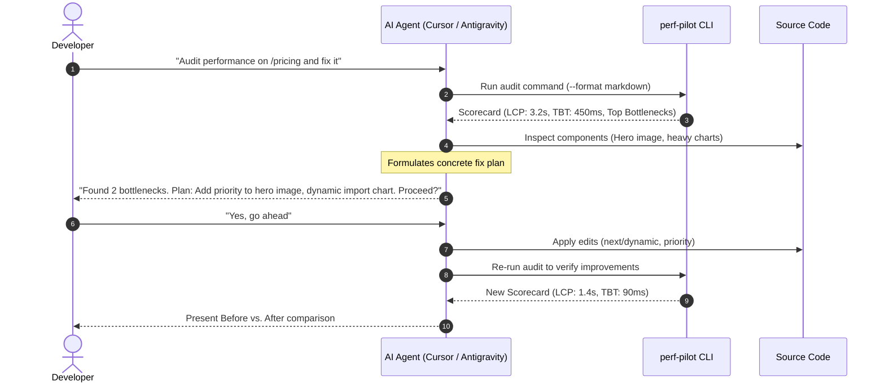

# ⚡ @azguards/ai-perf-pilot

> **Autonomous Core Web Vitals audit engine & AI agent skill scaffolder by Azguards.**  
> Test page performance, pinpoint bottlenecks, and enable your AI coding assistant (Antigravity, Cursor, Claude Code) to diagnose and fix web vitals with human-in-the-loop safety.

[](https://nodejs.org/)
[](LICENSE)
[](https://web.dev/vitals/)

---

## Features

- 🏎️ **Universal Lighthouse Engine**: Audits live HTTP URLs using headless Chrome. Measures **LCP**, **TBT**, **CLS**, **FCP**, and **Speed Index**.
- 🤖 **Turnkey AI Agent Skills**: Installs ready-to-use skills in `.agents/skills/performance-audit/` and `.cursor/rules/perf-audit.mdc` so your AI can review performance and fix code autonomously.
- 🛡️ **Safe 5-Stage Protocol**: Enforces a mandatory **Confirmation Gate** before any AI modifies your files.
- 📊 **Multi-Format Output**: Beautiful colored terminal tables for developers, clean token-efficient Markdown for LLMs, and machine-readable `scorecard.json` for CI/CD.
- 🔍 **Framework Agnostic with Next.js/React Playbooks**: Works with any web app; includes specialized remediation recipes for Next.js 15/16 and React 19.

---

## Quick Start (1 Command)

In your project root directory, run:

```bash
npx @azguards/ai-perf-pilot init
```

### What `init` does automatically:
1. Detects your framework (`Next.js`, `Vite`, `Astro`, etc.) and package manager (`npm`, `pnpm`, `yarn`, `bun`).
2. Installs `@azguards/ai-perf-pilot` as a `devDependency`.
3. Creates a `perf.config.mjs` config file.
4. Adds `"perf:audit"` and `"perf:audit:desktop"` scripts to your `package.json`.
5. Scaffolds `.agents/skills/performance-audit/SKILL.md` and `.cursor/rules/perf-audit.mdc`.

---

## Asking Your AI to Audit & Fix Performance

Once initialized, you can prompt your AI assistant in **Antigravity**, **Cursor**, or **Claude Code**:

### Example Prompts:

> *"Run a performance audit on the homepage, diagnose any Core Web Vitals issues, and recommend fixes."*

> *"Audit `/contact` on mobile mode, explain why TBT is high, and propose a code change."*

> *"Audit all core routes from sitemap and give me a comparison scorecard."*

### How the AI Executes (5-Stage Protocol):



---

## Manual CLI Usage

You can also run audits directly in your terminal at any time:

### Audit Single URL
```bash
# Mobile (4G throttled emulated) — default
npm run perf:audit

# Desktop view
npm run perf:audit:desktop

# Audit specific route or URL
npx perf-pilot audit --url http://localhost:3000/contact

# Get AI-friendly Markdown output
npx perf-pilot audit --url http://localhost:3000/blog --format markdown

# Output pure JSON
npx perf-pilot audit --format json
```

### Full-Site Sitemap Audit
```bash
# Audit top 5 routes discovered from /sitemap.xml
npx perf-pilot audit --site

# Audit top 10 routes
npx perf-pilot audit --site --limit 10

# Audit desktop mode with custom output directory
npx perf-pilot audit --site --desktop --output-dir .my-reports
```

---

## Configuration (`perf.config.mjs`)

You can customize targets and thresholds in `perf.config.mjs`:

```javascript
export default {
  // Default URL to audit
  baseUrl: 'http://localhost:3000',

  // Core routes to evaluate
  routes: [
    { name: 'Home', path: '/' },
    { name: 'Contact', path: '/contact' },
    { name: 'Blog', path: '/blog' },
  ],

  // Auto-discover URLs from /sitemap.xml
  discoverSitemap: true,

  // Quality thresholds
  thresholds: {
    performance: 85,  // Overall score (0-100)
    lcp: 2500,        // ms (Good: <= 2.5s)
    tbt: 200,         // ms (Good: <= 200ms)
    cls: 0.1,         // (Good: <= 0.1)
  },
};
```

---

## Artifacts Generated

After every audit run, `@azguards/ai-perf-pilot` writes clean, structured artifacts to `.perf-reports/`:
- **`scorecard.json`**: Machine-readable metrics, scores, and bottleneck rankings for CI/CD checks.
- **`summary.md`**: Token-efficient markdown table ideal for AI digestion or PR comments.

---

## Troubleshooting

### "Target server is not reachable at http://localhost:3000"
Start your local dev or production server before running an audit:
```bash
npm run dev
# or for true production scores:
npm run build && npm run start
```

### "Google Chrome or Chromium is required"
Install Google Chrome or set the `CHROME_PATH` environment variable:
```bash
# Windows PowerShell
$env:CHROME_PATH="C:\Program Files\Google\Chrome\Application\chrome.exe"

# macOS / Linux
export CHROME_PATH="/usr/bin/google-chrome"
```

---

## License

MIT © WhatATalk Team
